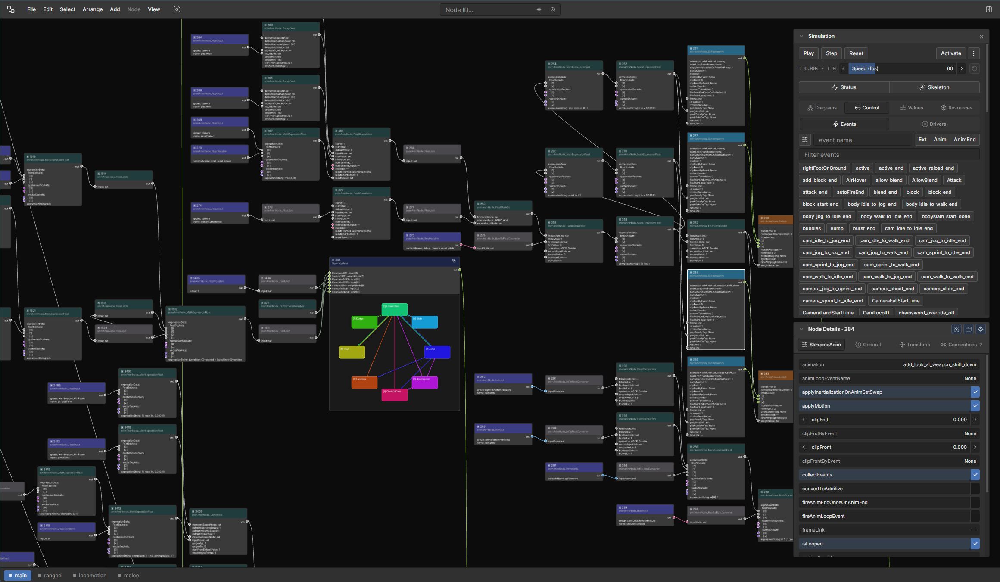
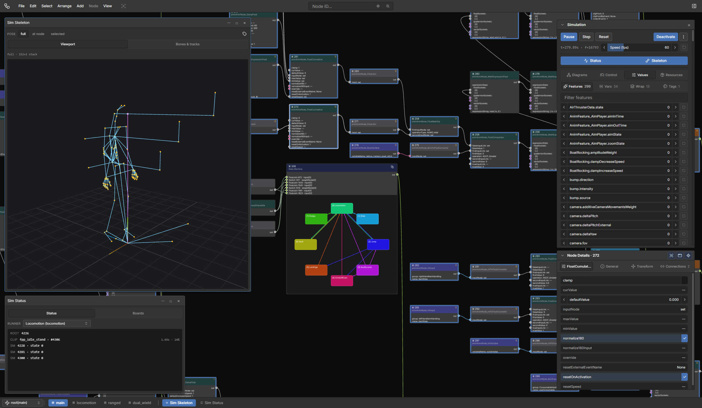

# Animgraph Editor

Desktop / web tool for inspecting and editing **Cyberpunk 2077** animation graphs (animgraphs) as an interactive node diagram.




## Features

- Open raw animgraph JSON, editor project files
- Multi animgraph simulation and edit support
- Hierarchical graph view with pan / zoom, nested scopes, and State Machine overview
- Edit layout (move, resize, arrange), connections, and node data
- Offline simulation of State Machines, transitions, and conditions
- **Live Bridge** — drive the sim from a running game (Simulation panel → Live Bridge)
- Sim clips from WolvenKit `.anims.json` (resolve SkAnim names, durations, events)
- Anim databases from WolvenKit C2dArray `.csv.json` (`animAnimNode_AnimDatabase` lookups)
- Save / export with round-trip back to animgraph JSON

## Live Bridge

Requires the [AnimgraphBridge](https://github.com/Oxion/cyberpunk-animgraph-bridge) RED4ext plugin in the game.

1. Install AnimgraphBridge into the Cyberpunk 2077 game root (see its README).
2. Start the game with the plugin loaded.
3. In the editor: **Simulation** panel → **Live Bridge** (host/port under **Settings → Live Bridge**, default `127.0.0.1:29770`).

## Quick start

### Run the app

```bash
npm install
npm run dev
```

Open [http://127.0.0.1:5001](http://127.0.0.1:5001).

Desktop (Electron):

```bash
npm run dev:electron
```

Production build (Windows Electron dir):

```bash
npm run electron:build
```

### First project + basic sim

See [BASIC_GUIDE.md](BASIC_GUIDE.md).

## License

[GPL-3.0](https://www.gnu.org/licenses/gpl-3.0.html) · [TorDalor](https://github.com/Oxion)